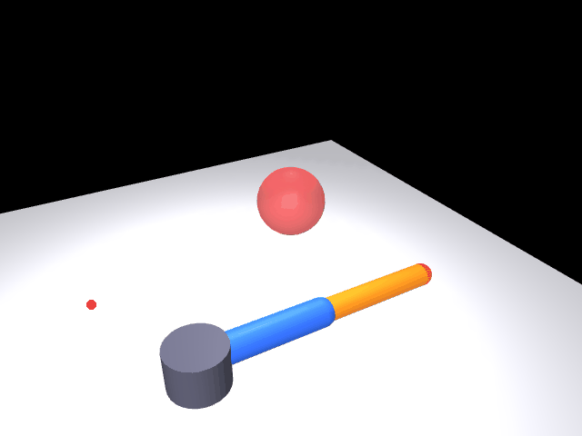

# 机械臂空间避障轨迹规划（mujoco_arm_avoid）设计与验证文档

## 1. 任务

在 MuJoCo 中搭建三自由度空间机械臂，末端从起点 A 运动到终点 B，
途中绕过红色球形障碍物，走一条安全轨迹并绘制避障路径动画。

## 2. 方案

### 2.1 模型

- 三自由度空间臂：肩方位 yaw（绕 Z）+ 肩俯仰 pitch1 + 肘俯仰 pitch2，
  杆长 L1 = L2 = 0.30 m，肩俯仰中心高度 0.06 m；
- 障碍球：半透明红色，球心 (0.25, 0.05, 0.34)，半径 0.07 m；
- 起点 / 终点：地面绿 / 蓝圆环标记。

### 2.2 任务点与避障路径

| 点 | 坐标 (m) | 说明 |
|---|---|---|
| A | (0.20, 0.05, 0.20) | 起点 |
| W | (0.42, -0.12, 0.36) | 避障途经点（绕障碍外侧） |
| B | (0.30, 0.05, 0.48) | 终点 |
| O | (0.25, 0.05, 0.34) | 障碍球心（r = 0.07） |

直线 A→B 会穿过障碍球，因此路径改为折线 **A → W → B** 两段线性插值
（共 330 个轨迹点，之后 120 帧在终点停留展示完整轨迹）。

### 2.3 空间 IK

```
r    = sqrt(x² + y²)                    # 水平距离
z'   = z - 0.06                         # 相对肩俯仰中心
d    = sqrt(r² + z'²)                   # 臂平面内距离
yaw  = atan2(y, x)                      # 肩方位（带跨 ±π 解缠）
q2   = acos((d² - L1² - L2²) / (2 L1 L2))   # 肘上
q1   = atan2(z', r) - atan2(L2 sin q2, L1 + L2 cos q2)
```

PD 位置控制（KP=40, KD=10），每帧 3 次 `mj_step`（dt = 2 ms）。

### 2.4 相机与渲染

- 相机：lookat (0.25, 0.05, 0.30)、distance 1.10、azimuth 60°、elevation -30°；
- 黄色末端轨迹线（RGB 255,200,0，宽 3）用手算 lookAt 透视投影叠加：
  `F = 240 / tan(22.5°) ≈ 579.4`（fovy = 45°）；
- 输出 450 帧 / 15.0 s 的 GIF。

## 3. 验证结果

### 3.1 IK 数值精度（轨迹抽样 20 点，逆解 → 仿真器正解互查，抽样 5 点）

| f | 目标 (m) | 正解 (m) | 误差 (mm) |
|---|---|---|---|
| 0 | (0.200, 0.050, 0.200) | (0.200, 0.050, 0.200) | 0.0000 |
| 118 | (0.373, -0.084, 0.326) | (0.373, -0.084, 0.326) | 0.0000 |
| 236 | (0.363, -0.039, 0.417) | (0.363, -0.039, 0.417) | 0.0000 |
| 354 | (0.300, 0.050, 0.480) | (0.300, 0.050, 0.480) | 0.0000 |

最大误差 **0.0000 mm**（PASS）。

### 3.2 避障安全距离

全程 450 帧逐帧检查末端到障碍球心距离：
最小距离 **0.106 m**（frame 49），满足安全间距要求 ≥ 0.10 m（PASS）。

### 3.3 渲染验证

- glfw 实时渲染：450 帧完整播放避障轨迹；
- 效果图 `docs/mujoco_arm_demo.gif`：3/4 视角下黄色末端轨迹
  从起点绕过红色障碍球外侧到达终点，路径清晰可见。

## 4. 效果图


